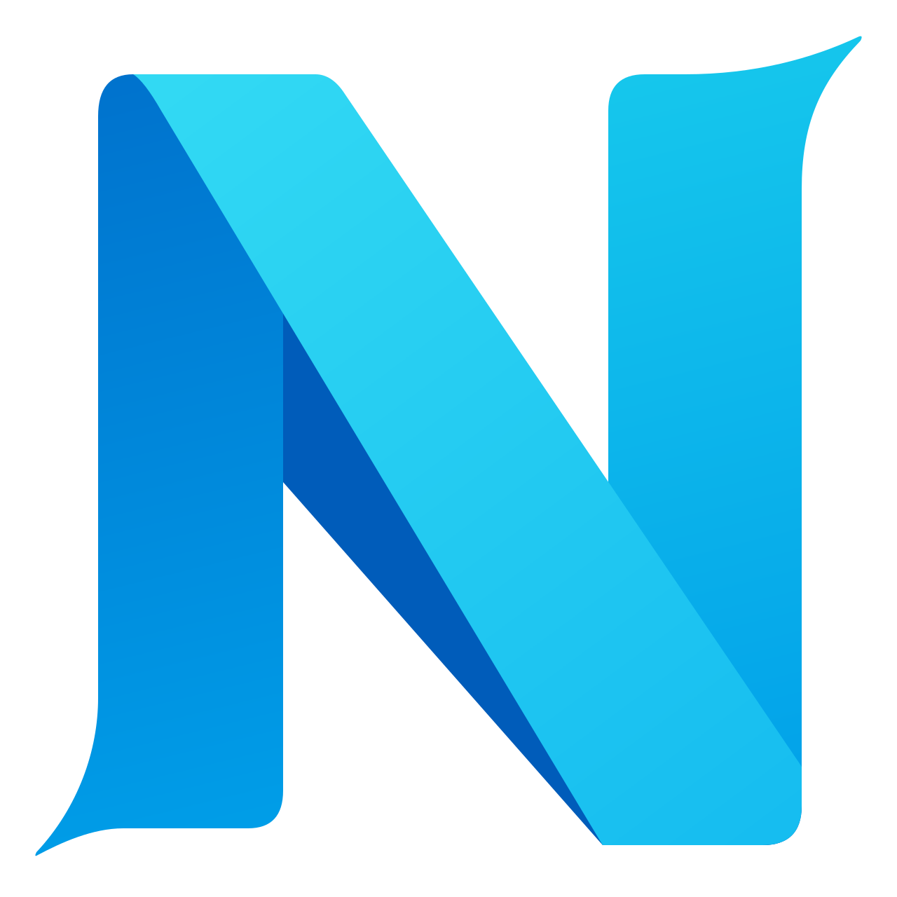

<picture>
  <source media="(prefers-color-scheme: dark)" srcset="assets/logo-dark.png">
  
</picture>

# Nyra VS Code extension

Provides Nyra syntax highlighting, themes, LSP features, and native debugging
for `.ny`, `.ni`, and `.nk` files. Semantic features come from the Nyra-built
`nyra-analyzer`; debugging builds with `nyrac` and delegates to CodeLLDB or
Microsoft C/C++.

## Features

- One `nyra` language id and grammar for `.ny`, `.ni`, and `.nk`.
- Transparent extension artwork and light/dark language file icons.
- Nyra Slate Dark and Nyra Mist Light themes.
- Analyzer diagnostics, hover, definition, and completion over stdio.
- **Nyra: Restart Analyzer** and **Nyra: Show Output** commands.
- **Nyra: Debug Current File** saves the current `.ny`, builds with
  argument-vector options, creates a source-relative binary under
  `.nyra-debug/`, generates a dSYM on macOS, and starts the selected debugger.
- **Nyra: Initialize Debug Workspace** writes or merges build tasks and native
  launch configurations for the active workspace folder.

## Prerequisites

Install a Nyra SDK containing `nyrac` and `nyra-analyzer`, either with
**Nyra: Install SDK** or from the official SDK release. The compiler and
analyzer are separate products; this extension repository does not contain
their source code.

The extension searches workspace roots, `NYRA_SDK`, SDK tool directories on
`PATH`, managed installations, `~/.nyra/sdk`, `~/.nyra/sdks`, `~/nyra-sdk` and
`~/.local/share/nyra/sdks`. An explicit `nyra.sdkPath` always takes precedence,
including when it is invalid. Use **Nyra: Select SDK** or the Nyra status-bar
entry to choose a discovered SDK or browse for another root.

The extension uses one selected SDK for the whole VS Code window; changing the
active editor does not switch toolchains. Compiler checkouts use `bin/nyrac`
and `bin/nyra-analyzer`; official bundles use the current host's
`hosts/<host>/bin/` directory beneath the SDK root. Analyzer/compiler path
overrides continue to take precedence over the selected SDK.

When the SDK or analyzer is missing, one notification offers **Select SDK**,
**Install SDK** and **Show Output**. Installation reads the latest stable
metadata from [nylang/sdk](https://github.com/nylang/sdk/releases), selects the
extension host's platform/architecture, and asks for a parent directory. The
default is the extension's own SDK storage. The complete official archive is
downloaded with progress and cancellation, verified against its SHA-256 and
extracted into a temporary directory. Manifest and tool hashes are also checked
before the SDK is moved into place and selected. Existing installations are
never overwritten; cancellation/failure removes partial staging files.
Selection starts the analyzer without requiring a window reload.

Use the SDK root, not its `bin` folder. Downloaded tools run on the extension
host (including Remote SSH/WSL), not necessarily the local desktop. Installation
does not change the system `PATH` or install OS developer tools; keep the native
SDK/CRT prerequisites described in the official SDK installation guide.

For debugging, install either [CodeLLDB](https://marketplace.visualstudio.com/items?itemName=vadimcn.vscode-lldb)
or [Microsoft C/C++](https://marketplace.visualstudio.com/items?itemName=ms-vscode.cpptools).
No debugger extension is installed or managed by Nyra.

## Local checks

```bash
npm ci
npm test
```

The VS Code Development Host can be started by opening this repository and
pressing F5. Open a `.ny`, `.ni`, or `.nk` file to activate the analyzer. To check
debugging, open a Nyra project, install a native adapter, and set a source breakpoint before choosing **Nyra: Debug
Current File**.

## Settings

| Setting | Default | Meaning |
|---------|---------|---------|
| `nyra.sdkPath` | Automatic discovery | SDK root; explicit value takes precedence and is held for the window |
| `nyra.analyzerPath` | `<sdk>/bin/nyra-analyzer` | Analyzer executable override |
| `nyra.compilerPath` | `<sdk>/bin/nyrac` | Compiler executable override |
| `nyra.debugAdapter` | `auto` | `auto`, `lldb`, or `cppdbg` |

Generated debug binaries keep the entry's relative path, so equal basenames in
different packages do not collide. macOS uses `dsymutil` before LLDB starts.
Workspace initialization preserves unrelated task and launch entries. Cancel
leaves existing files unchanged; malformed JSON is reported without rewriting
either file, and a failed two-file update rolls back the prior contents.

## Scope

The extension does not provide a custom DAP, parser, or compiler frontend. Test
explorer/CodeLens features, kernel-specific editing tools, marketplace publishing,
and signing are tracked separately.

## License

MIT; see [LICENSE](LICENSE). Dependency licenses remain their own.

This extension has an independent Git history. In the compiler workspace it is
mounted as the `ide/vscode` submodule. Its public repository is
[nylang/nylang-ide-vscode](https://github.com/nylang/nylang-ide-vscode). Generated VSIX files
and `node_modules/` are excluded from Git.


## Icons and local installation

The extension uses the approved blue folded N icon with shortened terminals and
simplified shading on a transparent background. Its editable SVG and 512 px PNG
are kept in `assets/icon-app.svg` and `assets/icon.png`. The README uses the same
single-letter mark. Select **Preferences: File Icon
Theme > Nyra (Seti)** for compact blue `NY`, `NI`, and `NK` letter glyphs matching
`.ny`, `.ni`, and `.nk` files. Other file associations retain the bundled Seti
appearance, including JavaScript and README icons. Light and dark variants are
included. The file glyphs use the same em size, baseline and font rendering as
Seti, with Go blue, condensed bold outlines and a slight optical slant. See
`themes/SETI-LICENSE.txt` and `themes/NYRA-FILE-ICONS-OFL.txt` for font notices.

Language fallback icons use `NY` when another theme permits them. A language
fallback alone cannot distinguish the three suffixes; choose Nyra (Seti) for
the extension-specific letter badges.

Install the newest VSIX using **Extensions: Install from VSIX**, then run
**Developer: Reload Window**. For a same-version local rebuild, use
`code --install-extension /path/to/extension.vsix --force`. Version 0.24.7 adds
SDK discovery, selection and verified installation, retaining the blue folded N.
The Nyra (Seti) file icon theme uses
its dedicated letter-glyph font.


### Maintaining the file glyphs

`scripts/build-file-icons.py` regenerates the small WOFF font and SVG outlines
from the pinned Roboto Condensed source. It requires `fonttools==4.67.0` only
when maintaining artwork; the installed extension has no Python dependency.
The source revision, digest and derivation parameters are recorded in
`themes/NYRA-FILE-ICONS-SOURCE.json`. Supply the original font and OFL file:

```sh
python3 scripts/build-file-icons.py --source-font /path/to/RobotoCondensed.ttf --source-license /path/to/OFL.txt --out-dir /path/to/generated-icons
```

Keep the generated font, outline exports, PNG fallbacks and license notice in
sync. The primary extension logo remains separate from these file glyphs.
